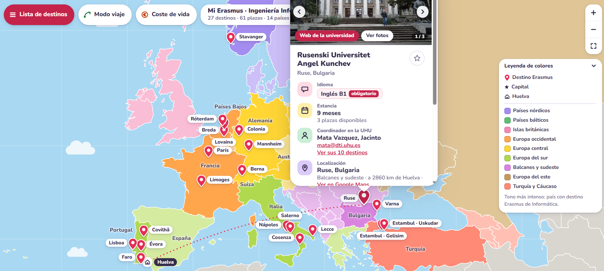

# Mapa Erasmus · Ingeniería Informática (UHU)

Mapa interactivo con los destinos Erasmus+ 2026/27 que la Universidad de Huelva ofrece al Grado en Ingeniería Informática.

**Web:** https://mapa-erasmus.pages.dev/

## Qué hace

- **Mapa de destinos:** cada plaza es una chincheta con su nombre. Al pulsarla se abre una ficha con idioma exigido, estancia, plazas, coordinador, localización, observaciones y enlace a la web de la universidad.
- **Fotos:** cada ficha muestra hasta tres fotos de la universidad o de la ciudad, tomadas de Wikimedia Commons.
- **Lista de destinos:** menú lateral con todas las fichas, buscador (universidad, ciudad, país o coordinador) y filtros por idioma, estancia, coordinador, región, coste de vida y favoritos.
- **Modo viaje:** al elegir un destino o un país, dibuja arcos hacia los países cuya capital está a menos de 750 km.
- **Coste de vida:** colorea los países según su nivel de precios comparado con España e indica el grupo de beca Erasmus.
- **Regiones:** los países se distinguen por colores (nórdicos, bálticos, Europa central, etc.).
- **Dos planes de estudios:** el de 2026 (6026) y el antiguo (6010), que solo se diferencian en un destino de Estambul.

## Datos

- **Plazas:** listado oficial de plazas Erasmus 2026/27 de la Universidad de Huelva, versión del 29/10/2026. Si la universidad lo actualiza, este mapa no cambia solo.
- **Coste de vida:** índices de nivel de precios de Eurostat (2024).
- **Becas:** cuantías de la financiación SEPIE de la UHU para 2025/26; pueden cambiar.
- **Fotos:** Wikimedia Commons, con autor y licencia indicados en cada imagen.
- **Mapa base:** Natural Earth, a través de `world-atlas`.

Este proyecto no es oficial. Antes de solicitar una plaza, comprueba siempre los requisitos en el listado de la UHU y con el coordinador correspondiente.

## Cómo está hecho

Es una única página estática (`index.html`) con HTML, CSS y JavaScript, sin servidor ni base de datos. Usa [D3](https://d3js.org/) y [TopoJSON](https://github.com/topojson/topojson) para dibujar el mapa. Está publicada con Cloudflare Pages, que la actualiza con cada `git push`.

## Autor

Pablo García Cruz, estudiante de Ingeniería Informática en la Universidad de Huelva. Desarrollado con la ayuda de Claude.
